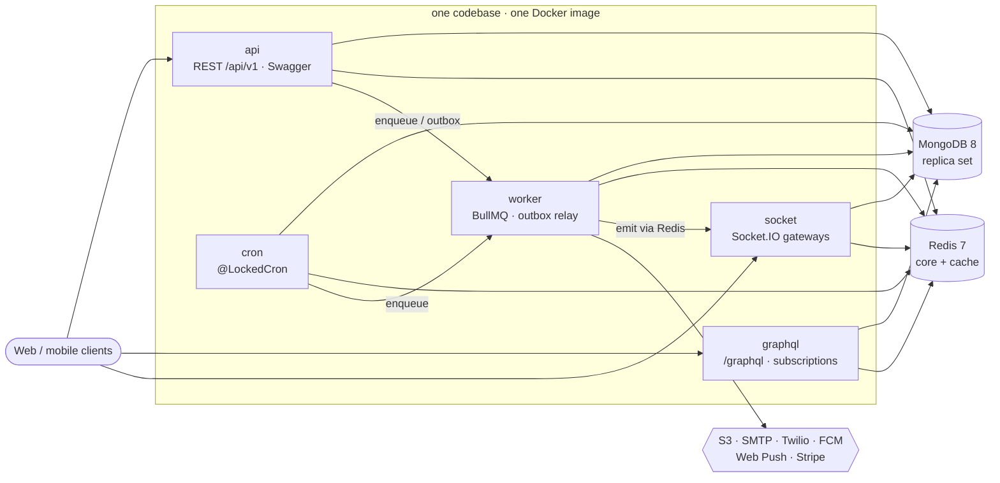

<div align="center">

# ⚓ nestjs-keel

### The keel your NestJS backend is built on.

A production-ready **NestJS 12** template: REST, GraphQL, Socket.IO, background jobs and schedules
running as separate processes from **one codebase and one image** — with MongoDB, Redis, BullMQ, S3,
e-mail, SMS, mobile + browser push, Stripe, gRPC and RabbitMQ wired in, tested and documented.

[](https://github.com/PrantaDas/nestjs-keel/actions/workflows/ci.yml)
[](LICENSE)
[](CONTRIBUTING.md)
[](https://www.conventionalcommits.org)
[](renovate.json)

**Runtime & language**<br>


**Data & messaging**<br>


**APIs**<br>


**Integrations**<br>


**Observability & quality**<br>


**Deploy**<br>


[Quick start](#-quick-start-about-5-minutes) ·
[What's inside](#-whats-inside) ·
[Tech stack](#-tech-stack-which-package-does-what) ·
[Patterns](#-patterns-and-principles) ·
[Validation](#-validation) ·
[Push](#-notifications-mobile-browser-inbox-e-mail) ·
[Commands](#-commands) ·
[Deploy](#-deploy) ·
[Docs](#-documentation)

</div>

---

## ✨ Highlights

|                                                                                                                                                             |                                                                                                                                                           |
| ----------------------------------------------------------------------------------------------------------------------------------------------------------- | --------------------------------------------------------------------------------------------------------------------------------------------------------- |
| 🧩 **Modular monolith, five processes.** api, graphql, socket, worker and cron boot their own root module from one codebase; scale each on its own.         | 🔌 **Ready to split into services.** Lint-enforced module boundaries, ports in `common/contracts`, an outbox, and gRPC + RabbitMQ behind one transport.   |
| 📜 **A contract clients can trust.** One response envelope, a central error registry with code ranges, human messages — all enforced by tests.              | 🕰️ **Time-zone-safe by construction.** Injected clock, business day, IANA zones only, lint rules against `new Date()`, test runs under four server zones. |
| 🔐 **Accounts done properly.** Sessions with refresh rotation and reuse detection, OTP, roles + permissions, audit trail, deletion grace period.            | 🛡️ **Resilient by default.** Timeouts, per-integration circuit breakers, send-once guards, graceful shutdown, health / readiness, heartbeats.             |
| 🔔 **Notifications everywhere.** One `Notifier` port: FCM for apps, Web Push (VAPID) for browsers, inbox and e-mail; deduped, unreachable accounts skipped. | 🚀 **Deploys anywhere.** Docker image, docker compose, Render Blueprint, PM2 + nginx for a VPS, CI, Renovate.                                             |

## 🧭 Architecture at a glance



Details: [architecture overview](docs/architecture/overview.md) · [processes](docs/architecture/processes.md).

## 📦 What's inside

| Area                                    | You get                                                                                                                                                                                                                                                               | Reference                                                                                                          |
| --------------------------------------- | --------------------------------------------------------------------------------------------------------------------------------------------------------------------------------------------------------------------------------------------------------------------- | ------------------------------------------------------------------------------------------------------------------ |
| **Accounts** (`modules/identity`)       | Register, password and one-time-code sign-in, refresh rotation with reuse detection, sessions list / revoke, password reset, e-mail and phone verification, avatar upload (S3 presigned), deactivate / delete with grace period, roles + permissions, super admin CLI | [security](docs/conventions/security.md), [threat model](docs/architecture/security.md)                            |
| **Admin**                               | Users (list, edit, disable, revoke sessions), audit log, notifications broadcast, payments, ops (queues, failed jobs, outbox, live processes)                                                                                                                         | `/api/docs` (Swagger)                                                                                              |
| **Notifications**                       | `Notifier` port: mobile push (FCM), browser push (Web Push / VAPID), inbox, e-mail; device tokens and browser subscriptions with pruning; deduped per occurrence; unreachable accounts skipped                                                                        | [integrations](docs/conventions/integrations.md#browser-push-web-push)                                             |
| **Payments** (optional)                 | Stripe checkout, portal, prices; signed webhook → queue → forward-only state                                                                                                                                                                                          | [integrations](docs/conventions/integrations.md#inbound-stripe-webhooks)                                           |
| **Example module** (`modules/examples`) | Notes: CRUD, v1/v2 with sunset, GraphQL, Socket.IO, cron → queue → push reminders, soft delete, cache, port over gRPC — the module `pnpm g:module` copies                                                                                                             | [module README](src/modules/examples/README.md)                                                                    |
| **API contract**                        | Response envelope, error registry with code ranges, human messages, OpenAPI with typed responses, versioning with Deprecation / Sunset                                                                                                                                | [responses](docs/conventions/responses.md), [errors](docs/conventions/errors.md), [messages](docs/api/messages.md) |
| **Realtime**                            | Socket.IO (WebSocket only, Redis adapter, emit from any process), GraphQL subscriptions                                                                                                                                                                               | [socket events](docs/api/socket-events.md), [GraphQL](docs/conventions/graphql.md)                                 |
| **Background work**                     | BullMQ with one policy table, `@LockedCron`, transactional outbox, send-once guard                                                                                                                                                                                    | [queues](docs/conventions/queues.md)                                                                               |
| **Data**                                | MongoDB replica set, repositories, transactions with retries, migrations, index sync, seed                                                                                                                                                                            | [database](docs/conventions/database.md)                                                                           |
| **Time**                                | Injected clock, business day, IANA zones only, DST-safe input, multi-zone test runs                                                                                                                                                                                   | [time](docs/conventions/time.md)                                                                                   |
| **Resilience & ops**                    | Timeouts, circuit breakers, graceful shutdown, health / readiness, heartbeats, pino logs, Sentry, OpenTelemetry                                                                                                                                                       | [fault tolerance](docs/architecture/fault-tolerance.md)                                                            |
| **Services later**                      | Ports between modules, lint-enforced boundaries, gRPC + RabbitMQ behind one transport                                                                                                                                                                                 | [microservices](docs/architecture/microservices.md)                                                                |
| **Deploy**                              | Docker image, docker compose, Render Blueprint, PM2 + nginx for a VPS, CI, Renovate                                                                                                                                                                                   | [deployment](docs/architecture/deployment.md)                                                                      |

Every environment variable is listed, grouped and explained in [`.env.example`](.env.example); the
boot validates them all ([`src/config/env.validation.ts`](src/config/env.validation.ts)).

## 🧰 Tech stack: which package does what

<details open>
<summary><b>Core framework and runtime</b></summary>

| Package                                                      | Used for                                                                                |
| ------------------------------------------------------------ | --------------------------------------------------------------------------------------- |
| `@nestjs/core`, `@nestjs/common`, `@nestjs/platform-express` | The framework: modules, dependency injection, guards, pipes, interceptors, on Express 5 |
| `@nestjs/config`                                             | Typed config namespaces (`registerAs`) over the validated environment                   |
| `@nestjs/event-emitter`                                      | In-process domain events, fed by the transactional outbox                               |
| `rxjs`, `reflect-metadata`                                   | NestJS runtime requirements (interceptor streams, decorator metadata)                   |
| `luxon`                                                      | Zone-aware date math inside `src/common/time` only (business day, DST-safe local times) |

</details>

<details>
<summary><b>Validation and API documentation</b></summary>

| Package                                 | Used for                                                                                            |
| --------------------------------------- | --------------------------------------------------------------------------------------------------- |
| `class-validator` + `class-transformer` | Request DTO validation and type conversion (`ValidationPipe`: whitelist, transform, human messages) |
| `joi`                                   | Environment schema: boot fails fast with every problem listed at once                               |
| `@nestjs/swagger`                       | OpenAPI document and Swagger UI; typed envelopes and per-route error codes (`@ApiEnvelope`, …)      |

</details>

<details>
<summary><b>Data</b></summary>

| Package                                                  | Used for                                                                           |
| -------------------------------------------------------- | ---------------------------------------------------------------------------------- |
| `mongoose`, `@nestjs/mongoose`                           | MongoDB schemas, repositories, transactions with retries on the replica set        |
| `mongoose-paginate-v2`, `mongoose-aggregate-paginate-v2` | Page / limit pagination for queries and aggregation pipelines (`BaseRepository`)   |
| `ioredis`                                                | Redis clients: sessions, OTP, locks, rate limits, send-once claims, cache, pub/sub |

</details>

<details>
<summary><b>APIs and realtime</b></summary>

| Package                                                              | Used for                                                                          |
| -------------------------------------------------------------------- | --------------------------------------------------------------------------------- |
| `@nestjs/graphql`, `@nestjs/apollo`, `@apollo/server`, `graphql`     | Code-first GraphQL on its own process                                             |
| `@as-integrations/express5`                                          | Apollo Server on Express 5                                                        |
| `graphql-ws`, `graphql-subscriptions`, `graphql-redis-subscriptions` | Subscriptions over WebSocket, fanned out across instances through Redis           |
| `graphql-query-complexity`                                           | Rejects queries above a depth / cost budget                                       |
| `dataloader`                                                         | Per-request batching (no N+1 in resolvers)                                        |
| `@nestjs/websockets`, `@nestjs/platform-socket.io`, `socket.io`      | Socket.IO gateways (WebSocket transport only)                                     |
| `@socket.io/redis-adapter`, `@socket.io/redis-emitter`               | Multi-instance rooms; emit to sockets from the worker or any other process        |
| `@nestjs/microservices`, `@grpc/grpc-js`, `@grpc/proto-loader`       | gRPC server and clients for a module's ports (types from `proto/` via `ts-proto`) |
| `amqplib`, `amqp-connection-manager`                                 | RabbitMQ RPC and domain-event publishing with automatic reconnects                |

</details>

<details>
<summary><b>Background work</b></summary>

| Package                    | Used for                                                                   |
| -------------------------- | -------------------------------------------------------------------------- |
| `bullmq`, `@nestjs/bullmq` | Queues and processors in the worker, one retry / backoff policy table      |
| `@nestjs/schedule`         | Cron schedules behind `@LockedCron` (one runner per tick across instances) |

</details>

<details>
<summary><b>Security</b></summary>

| Package                 | Used for                                                                                  |
| ----------------------- | ----------------------------------------------------------------------------------------- |
| `@nestjs/jwt`           | Short-lived access tokens and rotating refresh tokens (sessions live in Redis)            |
| `@nestjs/throttler`     | Rate limits per route and client, stored in Redis                                         |
| `helmet`, `compression` | HTTP hardening headers and response compression                                           |
| `node:crypto` (scrypt)  | Password hashing, no native add-on ([ADR 0012](docs/adr/0012-scrypt-password-hashing.md)) |

</details>

<details>
<summary><b>Integrations (each behind a port, each optional)</b></summary>

| Package                                               | Port             | Used for                                                      |
| ----------------------------------------------------- | ---------------- | ------------------------------------------------------------- |
| `@aws-sdk/client-s3`, `@aws-sdk/s3-request-presigner` | `FileStorage`    | Uploads and downloads with presigned URLs (SeaweedFS locally) |
| `nodemailer`                                          | `MailSender`     | E-mail over SMTP (Mailpit locally)                            |
| `twilio`                                              | `SmsSender`      | Text messages (one-time codes)                                |
| `firebase-admin`                                      | `PushSender`     | Mobile push through Firebase Cloud Messaging, topics          |
| `web-push`                                            | `WebPushSender`  | Browser push: VAPID signing and aes128gcm payload encryption  |
| `stripe`                                              | `PaymentGateway` | Checkout, customer portal, prices, signed webhooks            |

</details>

<details>
<summary><b>Observability</b></summary>

| Package                            | Used for                                                    |
| ---------------------------------- | ----------------------------------------------------------- |
| `pino`, `pino-http`, `nestjs-pino` | Structured JSON logs with request id, user id and redaction |
| `@sentry/nestjs`                   | Error reporting with release and environment                |
| `@opentelemetry/*`                 | Traces and metrics over OTLP, auto-instrumented             |

</details>

<details>
<summary><b>Tooling and tests</b></summary>

| Package                                            | Used for                                                                  |
| -------------------------------------------------- | ------------------------------------------------------------------------- |
| `jest`, `ts-jest`, `supertest`, `socket.io-client` | Unit, end-to-end (real MongoDB + Redis) and smoke tests                   |
| `k6` (external)                                    | Load test baseline (`pnpm test:load`)                                     |
| `eslint`, `typescript-eslint`, `prettier`          | Lint rules that enforce the architecture (boundaries, time, env) + format |
| `husky`, `lint-staged`, `@commitlint/*`            | Pre-commit checks and Conventional Commits                                |
| `@bufbuild/buf`, `ts-proto`                        | Protobuf lint and generated gRPC types                                    |
| `@nestjs/cli`, `@nestjs/schematics`                | Build (`nest build`) and the module generator's base                      |

</details>

## 🧱 Patterns and principles

| Pattern                               | Where                                                     | Why                                                                                                                        |
| ------------------------------------- | --------------------------------------------------------- | -------------------------------------------------------------------------------------------------------------------------- |
| **Modular monolith**                  | `src/modules/*`, one root module per process in `src/app` | One deployable while small; every module can leave later ([ADR 0001](docs/adr/0001-modular-monolith-and-process-model.md)) |
| **Ports and adapters** (hexagonal)    | `src/common/contracts`, `src/integrations/*/*.port.ts`    | Modules and providers are swapped (in-process ↔ gRPC, SDK ↔ fake) without touching callers                                 |
| **Repository**                        | `infra/database/base.repository.ts`                       | Queries, pagination and ownership filters in one place; services stay persistence-agnostic                                 |
| **Transactional outbox**              | `infra/events` (outbox + relay)                           | Domain events are written with the data and published at least once ([ADR 0009](docs/adr/0009-transactional-outbox.md))    |
| **Idempotent consumers**              | Processors, event handlers, `Idempotency-Key` interceptor | Retries and duplicates are safe; side effects run after the transaction commits                                            |
| **Claim before send**                 | `SendOnceGuard`, notification delivery claims             | A retried job never texts, mails or pushes twice                                                                           |
| **Circuit breaker + deadline**        | `integrations/resilience` (`guardedCall`)                 | A struggling provider fails fast instead of piling up requests                                                             |
| **Error registry**                    | `defineErrors(domain, [min, max], …)` per module          | Stable numeric codes and human messages clients can rely on ([errors](docs/conventions/errors.md))                         |
| **Response envelope**                 | `ResponseEnvelopeInterceptor`, `AllExceptionsFilter`      | One shape for every success and every error ([ADR 0003](docs/adr/0003-response-envelope.md))                               |
| **Clock injection**                   | `Clock`, `TimeService` in `common/time`                   | Deterministic tests, correct business days in any zone ([ADR 0006](docs/adr/0006-time-rules.md))                           |
| **Feature switches by configuration** | Lazy SDK clients, `INTEGRATION_NOT_CONFIGURED`            | A missing credential switches one feature off, never the boot ([ADR 0008](docs/adr/0008-feature-switches.md))              |
| **Soft delete, opt-in audit**         | `infra/database/soft-delete.ts`, `@Audit()`               | Restorable records and an audit trail where it matters ([ADR 0004](docs/adr/0004-soft-delete-and-audit-opt-in.md))         |

## ✅ Validation

Three layers, each with one job:

| Layer                    | Tool                                  | What it checks                                                                                                                          |
| ------------------------ | ------------------------------------- | --------------------------------------------------------------------------------------------------------------------------------------- |
| **Environment**          | Joi (`src/config/env.validation.ts`)  | Every variable typed and defaulted at boot; placeholder secrets and dev conveniences refused in production; all problems listed at once |
| **Requests**             | class-validator + class-transformer   | DTOs with `whitelist` + `forbidNonWhitelisted` (unknown fields refused), `transform` (types converted), nested objects validated        |
| **Messages people read** | `common/pipes/validation-messages.ts` | Every rule rendered as one plain sentence ("Title must be 200 characters or fewer."); a test fails on jargon or internals               |

Custom validators live in `src/common/validation` (`@IsPhone()` → E.164, `@IsNormalizedEmail()`,
`@IsStrongPassword()`), and a sanitiser strips `$` / `.` operator keys from every body and query
before validation.

```ts
export class CreateNoteDto {
  @ApiProperty({ maxLength: 200 })
  @IsString()
  @MinLength(1)
  @MaxLength(200)
  title: string; // → "Title must be 200 characters or fewer."
}
```

## 🔔 Notifications: mobile, browser, inbox, e-mail

Feature modules call one port and never a provider:

```ts
await this.notifier.notifyUsers({
  source: 'note-reminder',
  occurrenceKey: `${day}:note:${note.id}`, // at most one delivery per (source, key, user)
  userIds: [note.ownerId],
  title: 'Reminder',
  body: note.title,
  data: { url: `/notes/${note.id}` },
  channels: ['push', 'inbox'], // push = app devices (FCM) + browsers (Web Push)
});
```

**Browser push (Web Push with VAPID)** — no Firebase in the page, works in Chrome, Firefox, Edge and
Safari:

1. `pnpm webpush:keys` → put the pair in `WEB_PUSH_VAPID_PUBLIC_KEY` / `WEB_PUSH_VAPID_PRIVATE_KEY`.
2. The page fetches `GET /api/v1/notifications/web-push/public-key`, calls
   `pushManager.subscribe({ userVisibleOnly: true, applicationServerKey })` and sends
   `subscription.toJSON()` to `PUT /api/v1/notifications/web-push/subscriptions`.
3. `POST /api/v1/notifications/web-push/test` sends a test push to your own browsers and devices.

Subscriptions are only accepted on known push services (`WEB_PUSH_ALLOWED_HOSTS`), leave with their
session at sign-out, and are pruned when the push service answers 404 / 410. Service worker snippet
and every route: [integrations › browser push](docs/conventions/integrations.md#browser-push-web-push).

## ⚡ Quick start (about 5 minutes)

Needs Node 24, pnpm 11 (`corepack enable`) and Docker.

```bash
git clone https://github.com/PrantaDas/nestjs-keel.git my-api && cd my-api
pnpm install
cp .env.example .env              # works as is for local development
pnpm infra:up                     # MongoDB, Redis ×2, Mailpit, S3 (SeaweedFS), RabbitMQ
pnpm seed                         # optional: staff accounts + 50 people with history (prints passwords once)
pnpm dev                          # every process, one compiler, prefixed logs; Ctrl-C stops all
```

REST at http://localhost:3000/api/v1, Swagger at http://localhost:3000/api/docs, GraphQL at
http://localhost:3002/graphql, Socket.IO on :3001.

Check it:

```bash
curl -s localhost:3000/api/ready | jq .
curl -s -X POST localhost:3000/api/v1/auth/register -H 'content-type: application/json' \
  -d '{"name":"Ada","email":"ada@example.com","password":"correct-horse-42"}' | jq '.data.accessToken'
```

`pnpm dev` compiles once (`nest build --watch`) and runs api, graphql, socket, worker and cron
from `dist/`, restarting them after each successful rebuild (a build with type errors leaves them
running). Pick processes with `pnpm dev api graphql socket`, or one with `pnpm dev:api`. Run them in
**one** command: a second `pnpm dev` in another terminal would start a second compiler on the same
`dist/` and is refused. From the production image instead: `docker compose --profile app up --build`.

> [!TIP]
> **Try every channel at once:** with `pnpm dev` (or `pnpm dev api graphql socket`) running, start
> `pnpm playground` and open http://localhost:5173. The page signs up over REST, listens on Socket.IO
> and a GraphQL subscription, creates notes over REST, GraphQL and Socket.IO, and shows the pushes
> arriving. The **My notes** table is live: every `noteChanged` event on the GraphQL subscription
> reloads it and flashes the changed row (open two tabs signed in as the same person and pin or delete
> in one). **Run all checks** verifies the lot (13 checks).

Local tools: Mailpit inbox http://localhost:8025, RabbitMQ console http://localhost:15672
(guest/guest). With `OTP_DEV_LOG=true` (the default locally) one-time codes are
printed in the api log instead of sent; set it to `false` to send them through the worker to Mailpit.

## 🌱 Start your own project from it

1. On GitHub: **Use this template** (or `npx degit PrantaDas/nestjs-keel my-api` for a copy without
   history, then `git init`).
2. Rename it: `name`, `description`, `author`, `repository`, `homepage`, `bugs` in `package.json`;
   `APP_NAME`, `JWT_ISSUER`, `JWT_AUDIENCE` and `MAIL_FROM` in `.env.example` (and their defaults in
   `src/config/env.validation.ts`); `name` in `docker-compose.yml` and `.devcontainer/devcontainer.json`;
   the values in `render.yaml`; the copyright holder in `LICENSE`.
3. Keep the example module (`src/modules/examples`) while you learn the conventions: it is the
   reference `pnpm g:module` copies. Payments switch themselves off without a Stripe key; drop the
   `graphql` or `socket` process from your deployment if no client uses it.
4. Add your first module: `pnpm g:module invoices` ([CONTRIBUTING.md](CONTRIBUTING.md)).

## 🧵 Processes

| Process | Dev                | Port  | Does                                                     |
| ------- | ------------------ | ----- | -------------------------------------------------------- |
| api     | `pnpm dev:api`     | 3000  | REST `/api/v1`, Swagger `/api/docs`, Stripe webhook      |
| graphql | `pnpm dev:graphql` | 3002  | `/graphql`, subscriptions over `graphql-ws`              |
| socket  | `pnpm dev:socket`  | 3001  | Socket.IO gateways ([events](docs/api/socket-events.md)) |
| worker  | `pnpm dev:worker`  | –     | BullMQ processors, outbox relay, RabbitMQ RPC            |
| cron    | `pnpm dev:cron`    | –     | `@LockedCron` schedules                                  |
| grpc    | `pnpm dev:grpc`    | 50051 | Optional: a module's ports over gRPC                     |

Details: [docs/architecture/processes.md](docs/architecture/processes.md).

## 🔧 Commands

| Command                                                                | What                                                                                                  |
| ---------------------------------------------------------------------- | ----------------------------------------------------------------------------------------------------- |
| `pnpm dev [api graphql socket worker cron grpc]`                       | Run processes locally from one compiler (default: all but grpc); `pnpm dev:api` etc. for one          |
| `pnpm test` / `pnpm test:tz`                                           | Unit tests (no services) / under four server time zones                                               |
| `pnpm test:e2e` / `pnpm test:tz:e2e`                                   | End-to-end against compose services / under two zones                                                 |
| `pnpm test:smoke`                                                      | Read-only checks of running processes (see [testing](docs/conventions/testing.md))                    |
| `pnpm lint` · `pnpm typecheck` · `pnpm format`                         | Quality gates (also run by Husky and CI)                                                              |
| `pnpm g:module invoices`                                               | New feature module from the example, wired into every process                                         |
| `pnpm migrate status\|up\|down\|create <name>`                         | Data migrations                                                                                       |
| `pnpm db:sync-indexes [--apply]`                                       | Compare / create schema indexes (production runs with autoIndex off)                                  |
| `pnpm seed [--users 200] [--reset]`                                    | Local data (refuses non-local databases)                                                              |
| `pnpm admin:create --email you@example.com`                            | Create a super admin (password prompted, never a flag)                                                |
| `pnpm dev:token <userId>`                                              | Access token for a user, for curl, smoke and k6                                                       |
| `pnpm webpush:keys`                                                    | A VAPID key pair for browser push (`WEB_PUSH_VAPID_*`)                                                |
| `pnpm postman:export`                                                  | Postman collection + local environment from the OpenAPI document ([API docs](#-api-docs-and-postman)) |
| `pnpm openapi:export` · `pnpm messages:export` · `pnpm graphql:schema` | Generated contracts (tests fail when stale)                                                           |
| `pnpm proto:gen` · `pnpm proto:lint`                                   | gRPC types from `proto/`                                                                              |
| `pnpm playground`                                                      | Browser page on :5173 exercising REST, GraphQL, subscriptions and Socket.IO together                  |
| `pnpm infra:up` · `pnpm infra:down`                                    | Local services                                                                                        |

## 📖 API docs and Postman

### Swagger (OpenAPI)

With the api running and `SWAGGER_ENABLED=true` (the local default in `.env.example`):

| What                                 | Where                                  |
| ------------------------------------ | -------------------------------------- |
| Swagger UI                           | http://localhost:3000/api/docs         |
| OpenAPI JSON                         | http://localhost:3000/api/docs-json    |
| OpenAPI file (no running app needed) | `pnpm openapi:export` → `openapi.json` |

- Every route is documented: success envelope, its own error codes with the exact messages,
  auth, request examples. `test/unit/openapi-contract.spec.ts` fails the build when a route is not.
- Try routes from the UI: **Auth › Sign up** (or **Sign in**), copy `data.accessToken`, press
  **Authorize** and paste it under `bearer`. Machine routes use the `apiKey` scheme (`x-api-key`).
- v1 and v2 routes are both listed; older versions carry a `V1` suffix on their operation id.
- Keep it off in production (`SWAGGER_ENABLED=false`, the schema's default); hand out
  `openapi.json` instead. GraphQL has its own schema: [`schema.gql`](schema.gql), and GraphiQL at
  http://localhost:3002/graphql in development.

### Postman collection

```bash
pnpm postman:export     # → postman/nestjs-keel.postman_collection.json
                        #   postman/nestjs-keel.local.postman_environment.json
```

1. In Postman: **Import** → drop both files → select the **nestjs-keel (local)** environment.
2. Run **Auth › Create an account…** (or **Sign in…**). The collection stores `accessToken` and
   `refreshToken` from any response that returns them, and every signed-in request sends
   `Bearer {{accessToken}}`; public routes send nothing, machine routes send `x-api-key: {{apiKey}}`.
3. Change `email` / `password` in the environment to sign in as someone else; `timeZone` is sent
   as `X-Timezone` on every request.

Requests are grouped by Swagger tag, bodies come from the schema examples, path parameters (`:id`)
and optional query parameters are Postman variables. For staging or production, duplicate the
environment and change `baseUrl`. The files are generated (git-ignored): regenerate after API
changes and share them with your team, or attach them to a release. `pnpm postman:export
<openapi.json> <dir>` converts another document or writes elsewhere.

Prefer no generated files? Postman can also **Import → Link** `http://localhost:3000/api/docs-json`
directly, without the stored tokens and variables above.

## 🚢 Deploy

| Target                 | Start here                                                                                                                               |
| ---------------------- | ---------------------------------------------------------------------------------------------------------------------------------------- |
| Render                 | `render.yaml` → Dashboard → New → Blueprint ([guide](docs/architecture/deployment.md#render))                                            |
| Ubuntu VPS             | `ecosystem.config.cjs` (PM2) + `sudo deploy/vps/setup-nginx.sh <domain> <email>` ([guide](docs/architecture/deployment.md#vps-with-pm2)) |
| Any container platform | `Dockerfile`, one image, start command per process ([guide](docs/architecture/deployment.md))                                            |

## 📁 Layout

```
src/
  main.<process>.ts   entry points          app/          one root module per process + CoreModule
  config/             env schema + typed config            bootstrap/    HTTP hardening, shutdown
  common/             auth, errors, messages, time, contracts (ports between modules)
  infra/              database, redis, cache, queue, cron, realtime, graphql, events/outbox, transport, …
  integrations/       S3, mail, SMS, push (FCM + Web Push), Stripe behind ports + resilience
  modules/            identity, notifications, payments, ops, audit, examples (the module to copy)
  migrations/ cli/    data migrations, CLI tools
proto/                gRPC contracts               deploy/vps/   nginx site + setup script
test/                 unit contracts, e2e, smoke, k6
docs/                 architecture, conventions, ADRs, API catalogues
render.yaml           Render Blueprint             ecosystem.config.cjs   PM2 (VPS)
```

## 📚 Documentation

- Architecture: [overview](docs/architecture/overview.md) · [processes](docs/architecture/processes.md)
  · [fault tolerance](docs/architecture/fault-tolerance.md) · [security](docs/architecture/security.md)
  · [microservices](docs/architecture/microservices.md) · [deployment](docs/architecture/deployment.md)
- Conventions: [responses](docs/conventions/responses.md) · [errors](docs/conventions/errors.md)
  · [messages](docs/conventions/messages.md) · [time](docs/conventions/time.md)
  · [database](docs/conventions/database.md) · [queues](docs/conventions/queues.md)
  · [security](docs/conventions/security.md) · [integrations](docs/conventions/integrations.md)
  · [GraphQL](docs/conventions/graphql.md) · [versioning](docs/conventions/versioning.md)
  · [testing](docs/conventions/testing.md)
- Decisions: [docs/adr](docs/adr/README.md) · API catalogues: [messages](docs/api/messages.md),
  [socket events](docs/api/socket-events.md), [Swagger and Postman](#-api-docs-and-postman), GraphQL [schema.gql](schema.gql)
- Contributing: [CONTRIBUTING.md](CONTRIBUTING.md) · for coding agents: [AGENTS.md](AGENTS.md)

## 🩺 Troubleshooting

<details>
<summary>Common problems and their fixes</summary>

| Symptom                                                    | Fix                                                                                                                             |
| ---------------------------------------------------------- | ------------------------------------------------------------------------------------------------------------------------------- |
| Boot stops with a list of env problems                     | Read the list; compare with `.env.example`                                                                                      |
| `Cannot find module './…'` from `dist/`                    | Several compilers share `dist/` (e.g. one `nest start --watch` per terminal). Stop them all and run one `pnpm dev [processes…]` |
| `pnpm dev is already running here`                         | Another `pnpm dev` runs in this checkout: stop it, start every process you need in one command                                  |
| `/api/ready` says `mongodb: down`                          | `pnpm infra:up`; the URI must include `directConnection=true` locally (replica set)                                             |
| Port 27047 / 6389 / 6390 in use                            | Another compose project: `docker ps`, or change the host port in `docker-compose.yml` and `.env`                                |
| `ERR_REQUIRE_ESM` or "Cannot use import statement" in Jest | Run tests through `pnpm test` (sets `--experimental-vm-modules`)                                                                |
| E2E fails with "refuses a remote database"                 | `MONGO_URI` points off this machine; tests only run locally                                                                     |
| Codes never arrive                                         | With `OTP_DEV_LOG=true` they are in the api log; otherwise start `pnpm dev:worker` (it sends them)                              |
| Uploads fail with "not set up yet"                         | `S3_BUCKET` empty, or `s3-init` did not run: `docker compose up s3-init`                                                        |
| Payments routes answer "not set up yet"                    | Set `STRIPE_SECRET_KEY` and `STRIPE_WEBHOOK_SECRET` (see [integrations](docs/conventions/integrations.md))                      |
| Browser push routes answer "not set up yet"                | `pnpm webpush:keys`, then set `WEB_PUSH_VAPID_PUBLIC_KEY` and `WEB_PUSH_VAPID_PRIVATE_KEY`                                      |
| Browser subscription refused (code 4002)                   | Its push service is not in `WEB_PUSH_ALLOWED_HOSTS`; add the host if you trust it                                               |
| `docker compose --profile app up` fails at boot            | It reads `.env` for secrets (copy `.env.example`); compose itself points the URLs at the service names                          |

</details>

## 📄 License

[MIT](LICENSE) © Pranta Das

<div align="center">
<sub>Built with ⚓ for backends that have to stay afloat.</sub>
</div>
